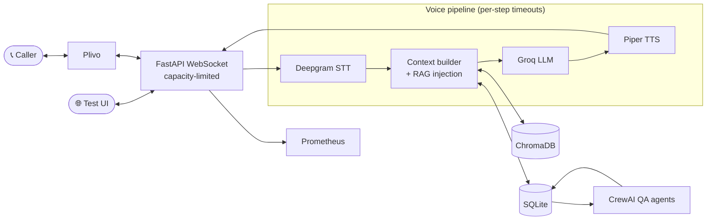

# BharatVoice: PRD & Technical Documentation

| | |
|---|---|
| **Product** | BharatVoice (भारतवॉइस) |
| **Version** | v0.3 |
| **Owner** | Amal Bajpayee |
| **Status** | Active development |
| **Last updated** | 27 October 2026 |

> **Note:** Sections marked *(indicative)* describe intended or inferred design and should be checked against the code before being treated as final.

---

# Part A: Product Requirements Document (PRD)

## 1. Summary

BharatVoice is a self-hosted voice AI platform that answers inbound phone calls for local Indian businesses in Hindi, English and Hinglish. It handles common requests (reservations, menu questions, opening hours) autonomously, grounds answers in the business's own data, and reviews its own calls for quality.

## 2. Problem Statement

- Local businesses (restaurants, clinics, shops) miss a large share of calls during rush hours and after closing, and each missed call is lost revenue.
- A dedicated receptionist is costly for a small business.
- Existing voice-AI products are priced for enterprises and handle Indian code-switching (Hindi + English in one sentence) poorly.
- Businesses are wary of sending customer phone numbers and conversations to opaque third-party platforms.

## 3. Goals & Non-Goals

### Goals
1. Answer inbound calls naturally in Hindi, English and Hinglish with conversational latency.
2. Complete core tasks end-to-end: table reservations, menu queries, hours and policies.
3. Keep running cost low enough for a single small business (~$16–27/month).
4. Let one deployment serve multiple businesses, routed by phone number.
5. Give owners a way to manage knowledge (menu, FAQ) and verify it before going live.
6. Continuously improve quality through automated transcript review.
7. Protect customer privacy by default.

### Non-Goals (current version)
- Outbound calling or campaigns.
- Payments over the phone.
- Regional languages beyond Hindi/English/Hinglish.
- Deep POS or booking-system integrations.
- A multi-tenant SaaS billing layer.

## 4. Target Users

| Persona | Description | Key needs |
|---|---|---|
| **Business owner** (primary) | Runs a restaurant or clinic, non-technical | Never miss a booking, low cost, easy menu/FAQ updates |
| **Caller / customer** | Speaks Hindi, English or a mix | Quick answers, no waiting, natural conversation |
| **Operator / developer** | Deploys and maintains the system | Simple self-hosting, observability, clear config |
| **Reviewer / manager** | Checks call quality | Scores, issues and fix suggestions per call |

## 5. User Stories

**Caller**
- As a caller, I want to book a table by speaking naturally in Hinglish so that I don't have to wait on hold.
- As a caller, I want to ask what's on the menu or the opening hours and get an accurate answer.
- As a caller, I want to interrupt the bot when it's speaking (barge-in).

**Business owner**
- As an owner, I want to edit menu items with Hindi translations so the bot speaks them correctly.
- As an owner, I want to test the bot's answers before going live.
- As an owner, I want to see call logs, transcripts and reservations.

**Operator**
- As an operator, I want to route different phone numbers to different businesses.
- As an operator, I want latency and retrieval metrics in Prometheus.

**Reviewer**
- As a reviewer, I want each call scored 1–5 with categorised issues and suggested fixes.

## 6. Functional Requirements

| ID | Requirement | Priority | Status |
|---|---|---|---|
| FR-1 | Real-time STT → LLM → TTS voice pipeline over WebSocket | P0 | ✅ Done |
| FR-2 | Hindi, English and Hinglish understanding and replies | P0 | ✅ Done |
| FR-3 | Inbound telephony via Plivo | P0 | ✅ Done |
| FR-4 | Table reservations (party size, date, time) with business-rule limits | P0 | ✅ Done |
| FR-5 | Menu, hours and policy answers via RAG over ChromaDB | P0 | ✅ Done |
| FR-6 | Multi-business routing by phone number with safe fallback | P0 | ✅ Done |
| FR-7 | Barge-in (caller can interrupt) | P1 | ✅ Done |
| FR-8 | Admin editors: menu, FAQ, knowledge test | P1 | ✅ Done |
| FR-9 | Call logs and transcripts with PII masking | P1 | ✅ Done |
| FR-10 | Automated transcript QA: score, classify issues, suggest fixes | P1 | ✅ Done (v0.3) |
| FR-11 | Transcript Reviews API and React admin views | P1 | ✅ Done (v0.3) |
| FR-12 | Prometheus metrics (latency, RAG hit rate) | P1 | ✅ Done |
| FR-13 | Browser-based voice test UI | P2 | ✅ Done |
| FR-14 | Business config via YAML | P2 | ✅ Done |

## 7. Non-Functional Requirements

| Category | Requirement |
|---|---|
| **Latency** | STT P50 < 300 ms · LLM P50 < 500 ms · TTS P50 < 200 ms · end-to-end P95 < 1.2 s |
| **Privacy & security** | Phone numbers encrypted with AES-256-GCM; PII masked in admin views; safe routing fallback for unknown numbers |
| **Reliability** | Per-step timeouts; WebSocket capacity limits; transactional consistency between DB and vector store |
| **Cost** | ~$16–27/month operational cost |
| **Portability** | Self-hostable via Docker or process manager |
| **Observability** | Prometheus metrics; accurate percentile calculation (linear interpolation) |
| **Data integrity** | Unique constraints prevent duplicate reviews under concurrency |

## 8. Success Metrics

| Metric | Target |
|---|---|
| Call completion without human handoff | Track and improve release over release |
| Average QA score (1–5) | ≥ 4.0 |
| Reservation success rate | Track per business |
| End-to-end P95 latency | < 1.2 s |
| Knowledge-gap issues flagged by QA | Decreasing trend |
| Monthly running cost per business | ≤ $27 |

*(Baselines for the tracked metrics should be recorded once real call volume exists.)*

## 9. Scope

**In scope (v0.3):** inbound calls, restaurant reservations and Q&A, multi-business routing, RAG knowledge base, admin tools, CrewAI QA.

**Out of scope:** outbound calls, payments, other languages, deep third-party integrations.

## 10. Roadmap *(indicative)*

| Phase | Theme | Candidate items |
|---|---|---|
| **v0.4** | Vertical expansion | Clinic appointment template; configurable intents per business |
| **v0.5** | Integrations | Calendar / WhatsApp confirmations; webhook events |
| **v0.6** | Intelligence | Auto-apply approved QA suggestions to the knowledge base; call summaries |
| **v1.0** | Production hardening | Auth/roles for admin, PostgreSQL option, load-tested scaling guide |

## 11. Risks & Mitigations

| Risk | Impact | Mitigation |
|---|---|---|
| Third-party API outage (Deepgram, Groq, Plivo) | Calls fail | Per-step timeouts, graceful fallback replies, monitoring |
| STT errors on accents/noise | Wrong bookings | Confirmation read-back, QA classifier flags STT errors |
| LLM hallucination | Incorrect info to callers | RAG grounding, knowledge test page, QA review |
| PII exposure | Privacy breach | Encryption, masking, safe routing |
| Cost drift at higher call volume | Margin loss | Metrics on usage; model/provider swap possible |
| Single-node SQLite limits | Scaling ceiling | Roadmap item for PostgreSQL |

## 12. Open Questions

- What is the human-handoff policy when the bot cannot help?
- What call-recording and retention policy should apply (legal and consent requirements in India)?
- Which vertical should be productised next after restaurants?

---

# Part B: Technical Documentation

## 1. System Overview

BharatVoice is a Python 3.12 FastAPI service that bridges telephony audio to a streaming STT → LLM → TTS pipeline. Business knowledge is retrieved from ChromaDB, structured data lives in SQLite, and a post-call CrewAI workflow reviews transcripts.

### Technology stack

| Layer | Technology |
|---|---|
| API / WebSocket | FastAPI 0.115+, Uvicorn |
| Speech-to-text | Deepgram |
| LLM | Groq (llama-3.3) |
| Text-to-speech | Piper (Hindi voice `hi_IN-priyamvada-medium`); gTTS default and optional Edge TTS |
| Telephony | Plivo (WebSocket audio streaming) |
| Vector store / RAG | ChromaDB + embeddings |
| Database | SQLite via repositories; Alembic migrations |
| QA agents | CrewAI |
| Admin | React + TypeScript + Vite (Orval client); Streamlit dashboard |
| Observability | Prometheus |
| Tooling | uv, pytest, ruff, mypy, Docker |

## 2. Architecture



## 3. Source Layout

| Path | Responsibility |
|---|---|
| `src/api/routes/` | REST endpoints: Plivo webhooks, CRUD, transcript reviews |
| `src/api/websocket/` | Audio streaming handlers with capacity limits |
| `src/api/static/` | Browser voice test UI |
| `src/core/pipeline.py` | Voice pipeline orchestration with per-step timeouts |
| `src/core/session.py` | Call session state management |
| `src/core/context.py` | Business context builder for prompts |
| `src/services/stt/` | Deepgram client |
| `src/services/llm/` | Groq client with RAG injection |
| `src/services/tts/` | Piper (and fallback) TTS |
| `src/services/telephony/` | Plivo integration |
| `src/services/knowledge/` | ChromaDB retrieval and embeddings |
| `src/services/analysis/` | CrewAI transcript QA agents |
| `src/db/` | Models and repositories |
| `src/observability/` | Prometheus metrics |
| `web/` | React admin with generated API client |
| `admin/` | Streamlit pages: menu editor, FAQ editor, knowledge test |
| `config/` | Per-business YAML |
| `schemas/` | JSON Schema (source of truth for the API contract) |
| `migrations/` | Alembic migrations |

## 4. Call Lifecycle

1. **Inbound call** hits Plivo, which calls the BharatVoice webhook.
2. **Routing**: the dialled number is looked up to select the business. Unknown numbers go to a **safe fallback** rather than a wrong business.
3. **WebSocket** opens for bidirectional audio. A capacity limit rejects connections beyond the configured maximum.
4. **Greeting** (`GREETING_TEXT`) is synthesised and played.
5. **Turn loop:**
   1. Caller audio streams to Deepgram; final transcripts are emitted.
   2. The context builder assembles the business profile, session history and RAG snippets from ChromaDB.
   3. Groq generates the reply; reservation actions are applied against business rules (party size, advance window, hours).
   4. Piper synthesises audio, which is streamed back to the caller.
   5. If `BARGE_IN_ENABLED`, caller speech interrupts playback.
6. **Call end**: transcript and metadata persisted; phone numbers stored encrypted.
7. **Post-call QA**: CrewAI agents review the transcript (see §6).

Every stage in step 5 runs under its own timeout so one slow provider cannot stall the whole call.

## 5. Knowledge Base (RAG)

- **Sources:** menu items (with Hindi translations), FAQs, policies, announcements, authored through the admin editors.
- **Storage:** content in SQLite; embeddings in ChromaDB.
- **Consistency:** DB and vector store updates are ordered so that a DB commit happens before the embedding is finalised, preventing orphaned embeddings (v0.3 fix) and keeping the two stores transactionally consistent (v0.2).
- **Retrieval:** top-k semantic search per turn, injected into the LLM prompt.
- **Verification:** the *Knowledge Test* admin page lets owners query retrieval before going live.
- **Metrics:** RAG latency and hit rate exported to Prometheus.

## 6. Transcript QA (CrewAI)

| Agent | Role | Output |
|---|---|---|
| **QA Reviewer** | Reads the transcript, identifies problems | Quality rating 1–5 plus issue list |
| **Issue Classifier** | Categorises each issue | e.g. knowledge gap, STT error, UX issue |
| **Improvement Suggester** | Proposes fixes | Actionable suggestions with priorities |

Results are stored per call and exposed through the Transcript Reviews API. A **unique constraint** on the call/review pair prevents duplicate reviews when analysis is triggered concurrently.

## 7. API Surface *(indicative)*

The exact contract lives in `schemas/` (JSON Schema) and the OpenAPI document served by FastAPI at `/docs`. The React client is generated from it with Orval.

| Area | Purpose |
|---|---|
| Plivo webhooks | Answer/hangup callbacks for inbound calls |
| WebSocket audio | Bidirectional call audio streaming |
| Businesses | CRUD for business profiles and phone routing |
| Menu / FAQ / Knowledge | CRUD and retrieval testing |
| Calls & transcripts | Listing, detail, PII-masked views |
| Reservations | Listing and management |
| Transcript reviews | Score, issues and suggestions per call |
| Metrics | Prometheus scrape endpoint |
| `/voice` | Browser test client |

## 8. Data Model *(indicative)*

| Entity | Key fields |
|---|---|
| **Business** | name, config reference, routing phone number (encrypted) |
| **Call** | business, caller number (encrypted), started/ended times, transcript |
| **Reservation** | business, call, party size, date/time, status |
| **MenuItem** | business, name (en/hi), description, price, category |
| **FAQEntry** | business, question, answer, type (FAQ / policy / announcement) |
| **TranscriptReview** | call (unique), score 1–5, issues, suggestions, priorities |

Schema changes are managed through Alembic (`alembic revision --autogenerate`, `alembic upgrade head`).

## 9. Configuration

### Environment variables

| Variable | Required | Description |
|---|---|---|
| `GROQ_API_KEY` | ✅ | LLM access |
| `DEEPGRAM_API_KEY` | ✅ | STT access |
| `PLIVO_AUTH_ID` / `PLIVO_AUTH_TOKEN` | Telephony only | Plivo credentials |
| `PIPER_VOICE` | Optional | e.g. `hi_IN-priyamvada-medium` |
| `EDGE_TTS_ENABLED` | Optional | Toggle Edge TTS |
| `GREETING_TEXT` | Optional | First utterance of every call |
| `BARGE_IN_ENABLED` | Optional | Allow caller interruptions |
| `ENVIRONMENT` | Optional | Set to `production` when deployed |

Encryption keys are created with `python scripts/generate_keys.py`. Full list in `.env.example`.

### Business YAML (`config/business/<name>.yaml`)

Defines name, weekly opening hours and reservation rules (`max_party_size`, `advance_days`).

## 10. Security & Privacy

| Control | Detail |
|---|---|
| Encryption at rest | AES-256-GCM for phone numbers |
| PII masking | Applied in transcripts and admin views |
| Safe routing | Unknown dialled numbers use a defined fallback, never another tenant's data |
| Capacity limits | WebSocket connection cap guards against resource exhaustion |
| Secrets | API keys via environment variables; never committed |
| Transport | Terminate TLS at the reverse proxy (Caddy/nginx) |

**Recommended before wide production use:** add authentication and role-based access to the admin interfaces, define call-recording consent and retention policy, and rotate encryption keys on a schedule.

## 11. Performance & Observability

| Stage | Target (P50) | Observed |
|---|---|---|
| STT | < 300 ms | ~250 ms |
| LLM | < 500 ms | ~350 ms |
| TTS | < 200 ms | ~150 ms |
| End-to-end (P95) | < 1.2 s | ~1.0 s |

- Percentiles use linear interpolation for accuracy.
- Prometheus exposes pipeline-stage latency and RAG latency/hit rate.
- Suggested alerts: end-to-end P95 above target, elevated timeout rate per stage, WebSocket capacity saturation.

## 12. Deployment

### Docker
```bash
docker-compose up -d
```

### Manual
1. Set `ENVIRONMENT=production`.
2. Run under systemd or supervisor.
3. Place behind Caddy or nginx with SSL.
4. Expose the Plivo webhook and WebSocket URLs publicly over HTTPS/WSS.
5. Point Prometheus at the metrics endpoint.

### Cost profile
Approximately **$16–27/month** for a single business, driven mainly by telephony minutes plus STT/LLM usage and hosting.

## 13. Testing & Quality

| Area | Tooling |
|---|---|
| Unit / integration | `uv run pytest` (`--cov=src` for coverage) |
| Lint / format | `ruff check`, `ruff format` |
| Types | `mypy src/` |
| Manual voice checks | `scripts/test_tts.py`, `scripts/test_llm.py`, `scripts/chat_cli.py` |
| End-to-end | Browser test UI at `/voice` |

## 14. Known Limitations & Technical Debt

- SQLite limits horizontal scaling and concurrent writes; a PostgreSQL option is planned.
- Depends on external APIs (Deepgram, Groq, Plivo), so availability and latency follow those providers.
- TTS defaults differ by setup (Piper, gTTS, Edge TTS); document the chosen voice per deployment.
- Admin surfaces need authentication and roles before multi-user exposure.
- QA suggestions are advisory and not yet auto-applied to the knowledge base.

## 15. Glossary

| Term | Meaning |
|---|---|
| **STT / TTS** | Speech-to-text / text-to-speech |
| **RAG** | Retrieval-augmented generation: grounding LLM answers in retrieved documents |
| **Hinglish** | Hindi and English mixed within a sentence |
| **Barge-in** | Caller interrupts the bot while it is speaking |
| **P50 / P95** | 50th / 95th percentile latency |
| **PII** | Personally identifiable information |
