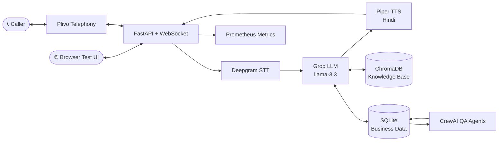

<div align="center">

# 🇮🇳 BharatVoice

### भारतवॉइस — *"conversation"*

**Self-hosted voice AI for local Indian businesses.**
Answers phone calls in Hindi, English and Hinglish, 24/7, for a fraction of the cost of a receptionist.

[](https://www.python.org/downloads/)
[](https://fastapi.tiangolo.com/)
[](#-admin-tools)
[](https://opensource.org/licenses/MIT)
[](https://github.com/AmalBajpayee09/BharatVoice/releases)
[](#-contributing)

[Quick Start](#-quick-start) · [Features](#-features) · [Architecture](#-architecture) · [Demo](#-demo-himalayan-kitchen) · [Docs](docs/PRD_and_Technical_Documentation.md) · [Contributing](#-contributing)

</div>

---

## 📖 Overview

Small restaurants, clinics and shops lose customers every day to **missed calls**. Hiring staff to answer phones is expensive, and most global voice-AI products don't understand how India actually speaks: a Hindi sentence with English words dropped in mid-way.

**BharatVoice** is a production-ready voice bot that picks up the phone, understands Hindi / English / Hinglish, answers from the business's own menu and FAQs, and takes reservations, all at roughly **$16–27 per month** in running costs.

> 🗣️ *"Table book karna hai, 4 log, kal shaam 7 baje."*
> → BharatVoice understands, checks availability, and confirms, in under a second.

---

## ✨ Features

| | Feature | What it gives you |
|---|---|---|
| 🎙️ | **Real-time voice pipeline** | Deepgram STT → Groq LLM → Piper TTS, **< 500 ms P50** processing |
| 🇮🇳 | **Native Hindi support** | Natural code-switching between Hindi, English and Hinglish |
| 📞 | **Telephony ready** | Plivo integration for inbound calls over WebSocket audio streaming |
| 🍽️ | **Restaurant demo** | Reservations, menu questions and opening hours, fully working |
| 🧠 | **Knowledge base (RAG)** | ChromaDB retrieval over menu items, FAQs and policies |
| 🏢 | **Multi-business** | One deployment, many businesses, routed by dialled phone number |
| 🤖 | **AI quality review** | CrewAI agents score every call and suggest fixes |
| 🔒 | **Privacy first** | AES-256-GCM phone encryption, PII masking, safe routing fallback |
| 💰 | **Cost effective** | ~$16–27/month operational cost |

---

## 🆕 What's New in v0.3

- **🤖 CrewAI transcript analysis**: a multi-agent QA system reviews call transcripts automatically
  - **QA Reviewer** finds issues and rates each call 1–5
  - **Issue Classifier** buckets problems (knowledge gap, STT error, UX issue, …)
  - **Improvement Suggester** produces prioritised, actionable fixes
- **⚛️ React admin frontend**: TypeScript + Vite with an Orval-generated API client
- **📝 Transcript Reviews API**: quality scores, issues and suggestions per call
- **📈 Accurate latency metrics**: percentiles computed with linear interpolation
- **🛡️ Concurrency safety**: unique constraints prevent duplicate reviews under load
- **🗄️ ChromaDB reliability**: correct commit ordering prevents orphaned embeddings

<details>
<summary><b>📋 Previous releases</b></summary>

### v0.2: Multi-Business & Knowledge Base
- Multi-business support with phone-number routing
- RAG-powered knowledge base (ChromaDB) for dynamic menu / FAQ answers
- Admin UI editors: menu editor, FAQ editor, knowledge test page
- Security hardening: safe phone-routing fallback, capacity limits, per-step timeouts
- Transactional consistency between the database and the vector store
- Prometheus metrics for RAG latency and hit rate

</details>

---

## 🏗️ Architecture



**Per-call flow:** caller audio streams in over WebSocket → speech is transcribed → the LLM answers using retrieved business knowledge → the reply is synthesised to speech and streamed back, with per-step timeouts at every stage. After the call, QA agents review the transcript.

---

## 🚀 Quick Start

### Prerequisites

- Python **3.12+**
- [uv](https://github.com/astral-sh/uv) (recommended) or pip
- API keys for [Deepgram](https://deepgram.com) and [Groq](https://groq.com)

### 1. Clone & install

```bash
git clone https://github.com/AmalBajpayee09/BharatVoice.git
cd BharatVoice

uv sync --all-extras
```

### 2. Configure environment

```bash
cp .env.example .env
nano .env
```

**Required**

| Variable | Purpose | Get a key |
|---|---|---|
| `GROQ_API_KEY` | LLM (conversation) | [console.groq.com](https://console.groq.com) |
| `DEEPGRAM_API_KEY` | Speech-to-text | [deepgram.com](https://deepgram.com) |

**Optional (telephony)**

| Variable | Purpose | Get a key |
|---|---|---|
| `PLIVO_AUTH_ID` | Phone calls | [plivo.com](https://plivo.com) |
| `PLIVO_AUTH_TOKEN` | Phone calls | [plivo.com](https://plivo.com) |

### 3. Generate security keys

```bash
python scripts/generate_keys.py
```

### 4. Run the server

```bash
uv run uvicorn src.main:app --host 0.0.0.0 --port 8000

# or with hot reload for development
uv run uvicorn src.main:app --reload
```

### 5. Try it

Open **http://localhost:8000/voice** → click **Start Call** → speak in Hindi, English or Hinglish → click **End Call**.

---

## 🎯 Demo: Himalayan Kitchen

The default configuration is a demo restaurant bot. Try saying:

| You say | Meaning |
|---|---|
| "Table book karna hai" | I want to book a table |
| "4 log, kal shaam 7 baje" | 4 people, tomorrow at 7 PM |
| "Menu mein kya hai?" | What's on the menu? |
| "Timing kya hai?" | What are your hours? |

---

## 🔧 Configuration

### Key environment settings

```bash
# LLM
GROQ_API_KEY=gsk_xxxx              # Required

# Speech-to-text
DEEPGRAM_API_KEY=xxxx              # Required

# TTS (optional, defaults to gTTS)
PIPER_VOICE=hi_IN-priyamvada-medium
EDGE_TTS_ENABLED=false

# Conversation
GREETING_TEXT=Namaste! ...
BARGE_IN_ENABLED=true              # Callers can interrupt the bot
```

See [`.env.example`](.env.example) for every option.

### Business configuration

Edit `config/business/himalayan_kitchen.yaml`:

```yaml
name: "Himalayan Kitchen"
hours:
  monday: closed
  tuesday: "11:00-22:30"
  # ...
reservation:
  max_party_size: 10
  advance_days: 30
```

---

## 📊 Admin Tools

```bash
uv run streamlit run admin/app.py     # → http://localhost:8501
```

- 📞 Call logs & transcripts (PII masked)
- 📅 Reservation management
- 📈 Analytics dashboard
- 🍽️ **Menu editor**: items with Hindi translations
- ❓ **FAQ editor**: FAQs, policies, announcements
- 🧪 **Knowledge test**: verify RAG retrieval before going live
- ⚙️ Configuration editor
- ⚛️ **React admin** (`web/`): transcript reviews, quality scores and suggestions

---

## 📈 Performance

| Metric | Target | Actual |
|---|---|---|
| STT latency (P50) | < 300 ms | ~250 ms |
| LLM latency (P50) | < 500 ms | ~350 ms |
| TTS latency (P50) | < 200 ms | ~150 ms |
| End-to-end (P95) | < 1.2 s | ~1.0 s |

---

## 📁 Project Structure

```
bharatvoice/
├── src/
│   ├── api/            # FastAPI routes & WebSocket handlers
│   │   ├── routes/     # REST endpoints (Plivo webhooks, CRUD, reviews)
│   │   ├── websocket/  # Audio streaming with capacity limits
│   │   └── static/     # Voice test UI
│   ├── core/           # Pipeline (per-step timeouts), sessions, context builder
│   ├── services/       # stt · llm · tts · telephony · knowledge · analysis
│   ├── db/             # Models & repositories
│   └── observability/  # Prometheus metrics
├── web/                # React admin (TypeScript + Vite, Orval client)
├── admin/              # Streamlit dashboard (menu / FAQ / knowledge test)
├── config/             # Business configuration (YAML)
├── migrations/         # Alembic migrations
├── schemas/            # JSON Schema (source of truth)
├── tests/              # Test suite
└── scripts/            # Utility scripts
```

---

## 🧪 Testing & Development

```bash
uv run pytest                      # all tests
uv run pytest --cov=src            # with coverage
uv run pytest tests/test_core/     # one module

uv run ruff check .                # lint
uv run ruff format .               # format
uv run mypy src/                   # type check

uv run alembic revision --autogenerate -m "description"
uv run alembic upgrade head
```

**Manual scripts:** `scripts/test_tts.py` (voice quality) · `scripts/test_llm.py` (LLM replies) · `scripts/chat_cli.py` (text-only conversation)

---

## 🚢 Deployment

**Docker**

```bash
docker-compose up -d
```

**Manual**

1. Set `ENVIRONMENT=production` in `.env`
2. Run under a process manager (systemd, supervisor)
3. Put it behind a reverse proxy (Caddy, nginx)
4. Configure SSL certificates

---

## 📚 Documentation

- [**PRD & Technical Documentation**](docs/PRD_and_Technical_Documentation.md): product requirements, architecture, data flow, security and roadmap

---

## 🤝 Contributing

Contributions are welcome!

1. Fork the repository
2. Create a branch: `git checkout -b feature/amazing`
3. Commit: `git commit -m "Add amazing feature"`
4. Push: `git push origin feature/amazing`
5. Open a Pull Request

---

## 📄 License

Released under the [MIT License](LICENSE).

## 🙏 Acknowledgments

[Deepgram](https://deepgram.com) (STT) · [Groq](https://groq.com) (LLM inference) · [Piper](https://github.com/rhasspy/piper) (offline Hindi TTS) · [ChromaDB](https://trychroma.com) (RAG) · [CrewAI](https://crewai.com) (QA agents) · [FastAPI](https://fastapi.tiangolo.com) · [Streamlit](https://streamlit.io)

---

<div align="center">

**Built with ❤️ by [Amal Bajpayee](https://github.com/AmalBajpayee09) for local Indian businesses**

Questions or suggestions? [Open an issue](https://github.com/AmalBajpayee09/BharatVoice/issues) · ⭐ Star the repo if it helps you!

</div>
